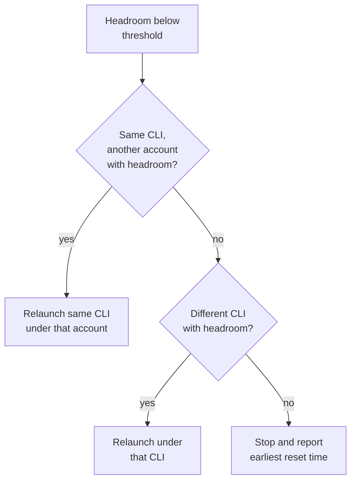

# Agent Failover on Usage Limits

2026-09-20

## Goal

When an agent runs out of usage headroom, Spacron should move the unfinished work to an agent that still has headroom and let it finish, without the user restarting anything.

Three requirements, as stated:

1. **Pick up where the last one left off.** The successor continues the same feature in the same place, not from scratch.
2. **Try another account of the same CLI first.** If two Claude Code accounts are signed in, check the second one's headroom before switching to a different CLI. Same for Codex.
3. **Switch before the wall, not at it.** At roughly 3-5% headroom remaining, mid-feature, redirect to an agent with enough left to finish.

Plus the round trip: report back into the same conversation when done, explain what was handed over and why, and let a reply route back to whichever agent is now holding the work.

## What already exists

Most of this feature is already built for other reasons. Six foundations carry it.

| Piece | Where | What it already does |
| --- | --- | --- |
| Usage meters | `src/lib/stores/usage.ts`, `src-tauri/src/commands/usage.rs` | Polls each signed-in CLI's own usage endpoint every 30s for `usedPercent`, `windowMinutes`, `resetsAtIso`. Claude, Codex, Gemini fully; Copilot, Cody, OpenCode, Amp partially. Tokens never leave Rust. |
| Multi-account | `src-tauri/src/commands/agent_accounts.rs` | Several accounts per CLI for Claude and Codex, by relocating the whole config dir (`CLAUDE_CONFIG_DIR`, `CODEX_HOME`). Spacron never writes a credential; the CLI writes its own during a normal login. |
| Account launch env | `src/lib/stores/terminal.ts:2455` | `accountEnvFor(command)` merged into the spawn env, under user overrides. The seam for launching under a chosen account already exists. |
| Worktree reuse | `src/lib/stores/orchestrator.ts:1696-1708` | `launchOrchestratorTask` reuses `task.worktree` on relaunch and launches in it. A successor lands in the dead agent's checkout, on its branch, with every edit in place. |
| Turn-end classifier | `src/lib/services/orchestrator/agent-turn-watch.ts:34-38` | `finished / blocked / failed / aborted`, each tagged `declared / exit / inferred`. Only a declared end may claim "finished". |
| Thread binding | `src/lib/stores/orchestrator.ts:255`, `:261` | `threadIdForTask` memoizes the thread-task link and `syncChatThreadTask` re-syncs it on every patch, so a thread survives relaunches. |

Two more worth naming:

- **The resume path is the failover path.** `sendFollowUpToAgent` (`orchestrator.ts:3219`) already handles a dead session: it re-leases a terminal, reuses `task.worktree.path`, patches the task back to in-progress, and builds a resume prompt as `Original goal / Previous request / User reply` (`:3297`). Today it relaunches the same preset. Pointing it at a different preset with a handover brief is most of the feature.
- **The steering buffer.** `steeringInboxes` (`orchestrator.ts:4152-4156`) holds a user's mid-flight correction and delivers it at the running turn's next tool round, rather than interleaving it into whatever the agent is doing. This is the "hold my prompt and pass it back at a safe moment" layer, already built for orchestrator brain turns.

## What is missing

Six gaps. Four are small widenings of existing functions; two are genuinely new logic.

| Gap | Size | What it needs |
| --- | --- | --- |
| Per-account metering | Small | `auth_file()` (`usage.rs:764`) resolves `active_credential_path`, so only the selected account can be read. `credential_path(spec, account_id)` (`agent_accounts.rs:170`) is already parameterized by account — thread the id through into a `usage_fetch_account(provider, account_id)`. |
| Per-account launch | Small | `usage_account_env` (`agent_accounts.rs:520`) reads `selected_account`. Add an optional `account_id` so an agent can launch under a non-active account without changing the user's global selection. Thread through `accountEnvFor` and `leaseOrchestratorTerminal`. |
| Limit classification | Small | Nothing distinguishes "stopped because out of headroom" from an ordinary stop. Add a `limited` variant to `AgentTurnOutcome` and a per-CLI limit phrase list beside `agentAttentionPhrases` in `agent-rules-file.ts`. |
| Successor policy | New | A pure ranking function over accounts and CLIs. No I/O, so it unit-tests cleanly. |
| Migration record | New | A list on the task: each hop's agent, account, headroom at the switch, and what it had finished. Feeds the completion card and tells a correction which agent is current. |
| Steering for leased agents | Medium | The buffer covers orchestrator brain turns. A correction typed while a leased CLI is mid-edit currently goes straight down the live-session path. |

Nothing here needs new architecture. The two new pieces are self-contained.

## The escalation ladder

Cheapest hop first. Another account of the same CLI costs nothing new and keeps identical capabilities, so it is always tried before a different CLI.

Ranking rules, in order:

1. **Same CLI, another signed-in account above the threshold.** Identical tools, identical prompt handling, and the CLI's own session resume may still carry the conversation.
2. **Same CLI, any further account.** Repeat until exhausted.
3. **A different CLI above the threshold**, preferring the eight in `MCP_CONFIGURABLE_EXECUTABLES` (`agent-capabilities.ts:38-49`) that can report back when done. Of the 39 presets in `runs.ts`, only those eight can *declare* a turn end; the rest leave the orchestrator inferring, which defeats the point of failing over for reliability.
4. **Nothing qualifies.** Stop, and tell the user when the earliest limit resets — the meters carry `resetsAtIso` per window, so this is a real time, not a shrug.

A later refinement worth noting but not building first: when the original account's limit resets, the work could hand *back*. The reset time is already in hand, so this is scheduling, not new detection.

## When to switch

Three triggers. The distinction that decides the design is **feature vs turn**: a feature is normally many turns, but a single dispatch to a CLI agent can also *be* one turn that runs twenty minutes and builds the whole feature. So "wait for the turn to end" can mean "wait for the feature to finish", which is the one behaviour this must not have. The handoff happens mid-feature, while the work is half-built.

### Mid-turn: the trigger that matters

The meter already polls every 30s, including while an agent is working. When the reading crosses the threshold mid-turn, act then — do not wait for a boundary that may be twenty minutes away.

The sequence, gentlest step first:

1. **Ask it to stop cleanly.** Send a wrap-up instruction into the running session: finish the edit in hand, commit, and stop. Most CLIs take a queued message at their next safe point.
2. **Grace window.** Give it 60-90s of output-quiet to comply. A CLI mid-tool-call usually lands within seconds.
3. **Interrupt.** If it has not stopped, `AgentAdapter.writeRaw('\u001b')` or Ctrl-C (`agent-adapter.ts:55`). The primitive exists; nothing new is needed.
4. **Freeze the state.** `stageWorktreeChanges` (`worktree-manager.ts:415`) commits whatever is in the checkout, so nothing is left floating and the successor inherits a clean tree.
5. **Hand over** — kill the session, build the brief from the worktree delta, relaunch the successor on the same branch.

### Pre-emptive: before a new dispatch

Cheaper and simpler: before dispatching a turn or follow-up, if headroom is already below the threshold, pick the successor now and never start a turn that cannot finish. This covers the multi-turn case and costs nothing.

### Reactive: it hard-stopped first

A limit can still land before the poll sees it. Detecting that needs two signals, corroborated:

- **A per-CLI limit phrase** in the transcript tail, added beside `agentAttentionPhrases` in `agent-rules-file.ts`.
- **The meter** showing that account at or near zero with a future `resetsAtIso`.

Either alone is a guess. The codebase learned this the hard way with bell detection: a terminal bell alone used to end turns instantly and discard the agent's real answer, so a bell now only *corroborates* a finish after a quiet period (`agent-turn-detection` note). Limit detection should follow the same rule, and for the same reason — a false positive throws away work.

### The mid-turn risk, and why it is acceptable

Stopping an agent mid-feature can leave a logically incomplete change: a function added with its caller not yet updated. That is real, and it is also exactly what a handover between two humans looks like. Three things contain it:

- The change is **on its own branch**, never in the user's working tree.
- `getWorktreeDelta()` reports precisely what landed, so the brief describes fact rather than the dead agent's intentions.
- The successor's first job is to read that diff and finish it, which is a normal task for a coding agent.

What would *not* be acceptable is killing an agent with no warning and no commit. Hence the wrap-up request and the staging step before the interrupt.

## Carrying the work across

**The worktree is the transfer.** There is no serialization format to design.

Each agent task already runs in its own git worktree on its own branch. `launchOrchestratorTask` reuses `task.worktree` when it exists (`orchestrator.ts:1696-1708`) and sets the launch cwd to it. So the handoff is: same task, swap `agentPreset` (and account env), relaunch. The successor opens in the dead agent's checkout with every edit in place, committed and uncommitted.

For a same-CLI account hop, that may be all that is needed — the CLI's own session resume can carry the conversation too.

### The handover brief

Crossing to a *different* CLI needs a written brief, because the successor has no history. Build it from evidence, not from the agent that just died:

- **The goal** — `task.goal`, already on the record.
- **What landed** — `getWorktreeDelta()` (`worktree-manager.ts:359`) reports what the branch actually contains versus the baseline. This is observed fact, not a claim.
- **What the agent said last** — the ANSI-stripped transcript tail already captured on `task.transcript`.
- **Why the handover happened** — from the migration record.

The orchestrator brain composes these into a brief. The dead agent is not asked to summarize its own unfinished work, because by definition it cannot answer.

### Kill before launch

Two agents must never run on one branch. `closeOrchestratorAgent` (`orchestrator.ts:1816`) already does the correct sequence — snapshot the transcript while the session is alive, `killSession`, then patch the task — and the comment at `:1826-1829` documents the completion race it was written to avoid. Reuse that path rather than hand-rolling a teardown.

### Where the finished work lands

Failover does not change how work reaches main, and should not. Because every hop reuses the same worktree and branch, three agents' work accumulates on **one** branch — so there is one review at the end, not one per agent.

What happens then follows the rules already in place:

- **Review wall (the default).** Auto-staging is off by default (`worktree-reconciler.ts`), so the branch's work appears in the "Agent changes" list for review. Nothing reaches main on its own.
- **Auto-staging on.** The reconciler applies the delta into the main checkout once the worktree goes quiet — as *staged, uncommitted* changes. The branch is always kept: "until the user commits, the branch is the only durable copy of the agent's work" (`worktree-manager.ts:402-413`).
- **A real merge into main** happens only through `mergeTaskWorktree`, and only behind an approval: a Reviewer's verdict (`orchestrator.ts:899`), an approved mailbox card (`:1093`), or the user pressing merge in the Fleet dashboard or the worktree review modal.

So the successor finishes the feature on the shared branch, and the merge gate is exactly the one that exists today. Whether a handed-over feature should merge automatically once the successor declares done is a setting, not a new mechanism — it inherits whatever answer the project already wants for ordinary agent work.

## Reporting back, and correcting

### Same thread, for free

Because failover reuses the same task, the thread binding survives every hop. `threadIdForTask` (`orchestrator.ts:255`) memoizes the link and `syncChatThreadTask` re-syncs it on each patch, so Claude-A → Claude-B → Codex all report into the conversation the work started in. Nothing to build.

### The completion card carries the migration story

The card written at `orchestrator.ts:2866` already holds `agentName`, `agentType`, `status`, `reason`, `summary`, `taskId` and `endedBy`, and lands in the owning thread. What it gains is the narrative, drawn from the migration record:

> Claude (work account) built the schema and the two mutations, then dropped to 3% with 4h to reset. Codex picked it up in the same branch and finished the handlers and tests.

**One constraint on that wording.** `endedBy` distinguishes `declared`, `exit` and `inferred`, and the existing rule is that only a declared end may use the word "finished" (`agent-turn-watch.ts:14-30`). The migration summary must keep that per hop: "Claude went quiet at 98%" and "Claude declared it was done" are different claims, and flattening them is how a user gets told work completed that never did.

### The correction loop

`sendFollowUpToAgent` (`orchestrator.ts:3219`) already handles both halves — a live session takes the reply directly, a dead one re-leases in the same worktree and rebuilds the prompt as `Original goal / Previous request / User reply` (`:3297`).

What the failover adds is routing: a correction must reach the agent **currently** holding the work, not the one that ran out. The migration record answers that, and `task.assignedSessionId` points at the live session.

The buffering described is `steeringInboxes` (`orchestrator.ts:4152-4156`), which holds a correction until the running turn's next tool round. Extending it to cover leased CLI agents is the one medium-sized piece of this section: right now a reply typed while Claude Code is mid-edit goes straight into the session.

## Risks and caveats

**macOS gives Claude only one account.** Documented at `usage.rs:928-933`: the login Keychain holds one credential item per CLI, so relocating the config dir does not give a second Claude account its own login. Account switching on macOS moves settings but not the login. On Windows and Linux the credential is a file inside the config dir, so multi-account works properly there. The ladder must detect this and skip straight to a different CLI on macOS, rather than hopping to an account that silently resolves to the same credential.

**Same plan, same limit.** Two accounts on the same billing plan share a limit. Checking the successor's headroom *before* launching — which per-account metering makes possible — is what stops a handoff into an immediate second stop.

**Only 8 of 39 CLIs can report back.** Outside `MCP_CONFIGURABLE_EXECUTABLES`, a successor can never declare it finished, so the orchestrator is back to inferring. Restrict automatic failover to those eight; anything else should be an explicit choice.

**A false limit reading throws away work.** This is why detection is corroborated rather than phrase-only. The cost of a false positive is a needless handoff mid-feature; the cost of a false negative is just the status quo.

**Cost and consent.** A same-CLI account hop spends the user's own plans and can reasonably be automatic. A cross-provider hop may spend money on a different service. Worth a setting, defaulting on, with the switch always visible in the activity log — there is an existing approval-card contract (`.spacron/memory/orchestrator-approval-cards.md`) if a card turns out to be wanted.

**Multi-hop bookkeeping.** Work may pass through three or more agents. The thread must show the chain rather than only the last hop, and a correction must route to the current holder. The migration record covers both, which is why it is a list and not a single field.

## Implementation plan

Five phases, each shippable on its own. Phases 1-3 deliver the whole feature for the common case; 4 and 5 harden it.

| Phase | Scope | Files | Done when |
| --- | --- | --- | --- |
| 1. See every account | Per-account metering and per-account launch env | `usage.rs`, `agent_accounts.rs`, `agentAccounts.ts`, `terminal.ts` | Headroom is readable for a non-active account, and an agent launches under a chosen account without changing the user's selection |
| 2. Choose a successor | The ranking function and the threshold setting | New module under `services/orchestrator/`, `settings.ts` | Pure unit tests cover: same-CLI hop preferred, macOS single-account case, nothing-qualifies case |
| 3. Hand over | Mid-turn headroom watch, wrap-up-and-interrupt, pre-emptive check, swap preset, reuse worktree, handover brief, migration record | `orchestrator.ts`, `worktree-manager.ts`, `task-lifecycle.ts`, `agent-adapter.ts` | An agent that crosses 3% **while building a feature** is stopped, its work committed, and another agent finishes that same feature on the same branch |
| 4. Explain it | Migration narrative on the completion card, respecting `endedBy` | `orchestrator.ts`, chat card components | The card names each hop, why it switched, and what each agent actually did |
| 5. Catch the hard stop | `limited` outcome, per-CLI limit phrases, meter corroboration; steering for leased agents | `agent-turn-watch.ts`, `agent-rules-file.ts`, `agent-signals.ts`, `orchestrator.ts` | A mid-turn limit stop is classified as `limited` rather than "went quiet", and a correction typed mid-edit is buffered |

**Sequencing note.** Phase 3 depends on 1 and 2; phase 5 is independent and could run in parallel. Phase 5 is also the riskiest — it touches the turn-detection path, where the existing notes record several expensive false-positive bugs.

**Testing.** Phases 1 and 2 are unit-testable without a running agent. Phase 3 onward needs a real agent hitting a real limit, which is hard to stage — worth building a way to force the threshold high ("treat anything under 99% as exhausted") so the path can be exercised on demand.

## Open questions

Worth settling before any code is written.

- [ ] **Threshold per window type.** One number, or separate ones for 5-hour and weekly windows? 3% of a weekly budget is far more work than 3% of a 5-hour one.
- [ ] **Which window triggers it.** A CLI can report several windows at once. Switch when *any* window is exhausted, or only when the binding one is?
- [ ] **Cross-provider consent.** Automatic, or a one-time approval per project? Same-CLI account hops seem clearly automatic either way.
- [ ] **Hand back on reset.** When the original account's limit resets mid-feature, hand the work back, or let the successor finish? Handing back means another handover brief and another context loss.
- [ ] **Non-reporting CLIs.** Hard-exclude anything outside the eight MCP-capable executables, or allow it with a weaker completion claim?
- [ ] **Failed handoff.** If the successor also fails — not on limits, but genuinely — does it escalate down the ladder again, or stop and ask? A ladder with no floor can burn every account on a broken task.
